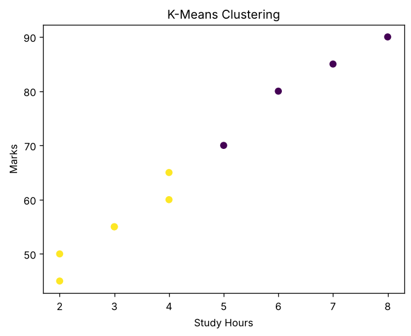

# K-Means Student Clustering

Beginner-friendly Python project that uses scikit-learn's K-Means to group students into two clusters based on study hours and marks, then plots the result with matplotlib. Includes a built-in sample dataset, requirements file, and README so you can run it in minutes.

## Setup

```bash
git clone https://github.com/<your-username>/kmeans-student-clustering.git
cd kmeans-student-clustering
pip install -r requirements.txt
```

## Usage

```bash
python main.py
```

The script builds a small DataFrame of `Study_Hours` and `Marks`, fits `KMeans(n_clusters=2, random_state=0)`, prints each student's cluster label, and opens a scatter plot colored by cluster. Edit the `data` dictionary at the top of `main.py` to try your own values, or change `n_clusters` to explore different groupings.

## Sample output

```
   Study_Hours  Marks  Cluster
0            2     50        1
1            3     55        1
2            4     65        1
3            5     70        0
4            6     80        0
5            7     85        0
6            8     90        0
7            2     45        1
8            3     55        1
9            4     60        1
```



## Notes

- Cluster numbers (0 and 1) are arbitrary labels, so they may swap between runs or library versions.
- `plt.show()` needs a display. On a headless server, set `MPLBACKEND=Agg` and use `plt.savefig("clusters.png")` instead.
